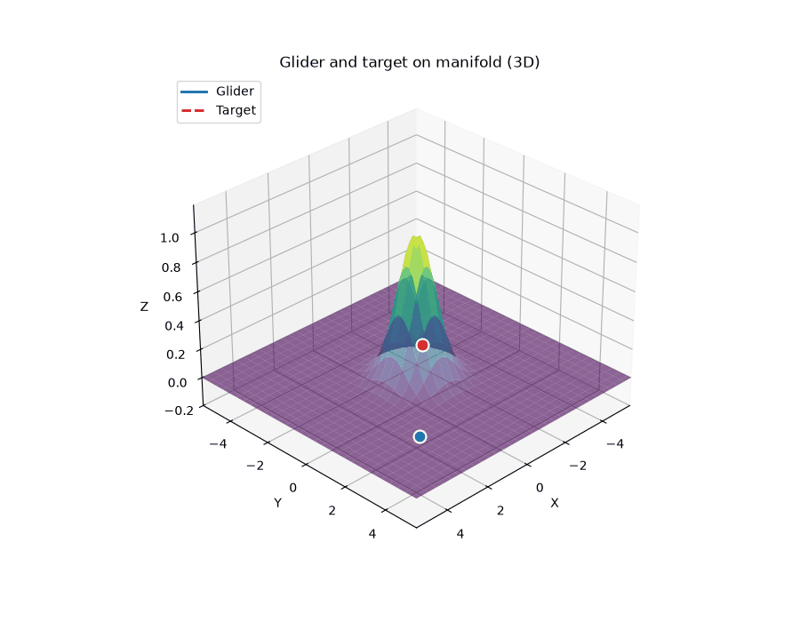

# Geodesic Glider — Interception Control on a Riemannian Surface

A study of continuous control in a pursuit problem. The target moves along a free geodesic on a two-dimensional surface, while the pursuer controls bounded thrust in the tangent plane. The project implements a Gymnasium simulator, a numerical integrator for geodesic motion, and the PPO-Clip algorithm with Generalized Advantage Estimation (GAE) in PyTorch. Geometry is incorporated into the equations of motion, the physical acceleration constraint, and the representation of the target's relative state.



**Checkpoint result.** With 100,000 environment steps of training, the stochastic policy in `baseline.pt` intercepted the target in **196 of 200 episodes (98.0%)** on the multi-hill training surface. The actor sampled a fresh action at every step with its weights and observation statistics frozen. An independent interactive demo session recorded **98 captures in 100 episodes** using the same action-selection rule. [Technical report](notebooks/riemannian_rl_report.ipynb) · [Checkpoint](models/baseline.pt)

## Problem Formulation

The surface is represented as a graph $r(q)=(u,v,f(u,v))$, where $q=(u,v)$. The state of each body consists of two coordinates and two coordinate velocity components. The target and pursuer start from independently sampled initial states. Their positions are sampled from normal distributions centered at $(-1,-1)$ and $(2,2)$, respectively, with unit variance along each axis (these parameters can be configured in `ppo_config` during training). Initial velocities are also random. An episode terminates when the target is intercepted, either body crosses the spatial boundary, or the time horizon is exhausted.

The induced metric, Christoffel symbols of the second kind, and controlled geodesic equation are given by

$$
g_{ij}=\delta_{ij}+f_i f_j,\qquad
\Gamma^k_{ij}=\frac{f_k f_{ij}}{1+\|\nabla f\|^2},\qquad
\ddot q^k=a^k-\sum_{i,j}\Gamma^k_{ij}\dot q^i\dot q^j .
$$

Here, $a^k$ denotes the components of tangential acceleration in the coordinate basis. For the target, $a=0$. Height derivatives are computed symbolically using SymPy when the environment is initialized; `lambdify` then generates numerical functions for the coefficients. The simulator uses the classical fourth-order Runge–Kutta method (RK4) with a timestep of $\Delta t=0.01$. The pursuer's acceleration is converted into the coordinate basis at the beginning of each step and held constant across all four integration stages. [Environment implementation](env/environment.py)

### Interface Between Geometry and the Policy

| Component | Implementation | Purpose |
|---|---|---|
| Thrust | Gram–Schmidt orthonormalization of $r_u,r_v$. The two action components are constrained to the unit disk and scaled by 30 | Ensures that the physical acceleration constraint is identical on both flat and steep regions |
| `local_state` · 8 | Chart positions of both bodies and two velocity components in each body's own orthonormal frame | Local kinematics of the pursuer and target |
| `global_state` · 12 | Positions and velocities of both bodies in the three-dimensional ambient space | Information about position and motion on the actual surface |
| `ego_features` · 6 | Projections of displacement and relative velocity onto the pursuer's tangent frame, Euclidean distance, and remaining time | Distinguishes approaching, receding, and transverse motion even at the same distance |
| Reward | $10(\hat d_{t-1}-\hat d_t)-(0.01+10^{-4}t)+5\,\mathbf 1_{\rm capture}$, with step numbering starting at one | Dense feedback for making progress, an increasing cost of time, and a terminal capture bonus |

To compute $\hat d$, the environment lifts ten points along the straight segment in chart coordinates onto the surface and sums the lengths of the resulting chords. This approximates the length of the chosen path. The shortest geodesic may follow a different path. The success criterion is evaluated separately: the minimum Euclidean distance along the linearly interpolated relative-motion segment must be less than 0.1. This means that crossing the capture region between two time steps is detected even when the relative displacement is large.

## PPO Architecture and Optimization

The actor receives 26 features (`local + global + ego`), while the critic receives 14 (`local + ego`). The networks do not share weights. Both use two hidden layers with 64 neurons each and LeakyReLU activations. The actor has 6,020 trainable parameters, including two learnable log-standard-deviation parameters; the critic has 5,185. [Networks](agent/network.py) · [PPO, rollout buffer, and normalization](agent/ppo.py) · [Environment interaction loop](agent/train.py)

| Engineering decision | Exact specification | Purpose |
|---|---|---|
| Diagonal Gaussian policy | Independent Gaussian components with a joint log-probability. The mean is bounded by $4\tanh(x/4)$, and the learnable state-independent log-std is clamped to $[-3, 0.5]$ | Separates the mean action direction from the exploration scale |
| Orthogonal initialization | Gain $\sqrt 2$ in hidden layers, 0.01 in the actor output, and 1 in the critic output. Biases are zero | Keeps the initial mean close to zero while the initial standard deviation equals one |
| Action and likelihood-ratio consistency | The buffer stores the Gaussian sample $z$ and its original $\log\pi(z\mid x)$. The environment receives $\tanh z$, followed by the norm constraint | Both probabilities in the PPO ratio are evaluated for the same random variable. The Jacobian of the mapping to physical thrust is not included in this objective |
| Online normalization | `RunningMeanStd` combines sample means and second central moments in float64. Local and global observations are standardized, while the six ego-centric features retain their physical scale | The buffer stores the inputs actually supplied to the networks. Reusing a rollout does not allow updated statistics to change the context of an earlier action |
| GAE and bootstrapping | $\gamma=0.99$, $\lambda=0.95$. Episode boundaries terminate the recursion; at an unfinished episode boundary at the end of a rollout, $V(s_{t+1})$ is used | Keeps trajectories from different episodes separate. The critic target $A_t+V_t$ is computed before advantage normalization across the rollout |
| Update-size control | PPO clipping of 0.2; entropy coefficient of 0.005; separate Adam optimizers with an initial LR of $3\cdot10^{-4}$ and $\epsilon=10^{-5}$; gradient norm limited to 0.5 for each network | The mean KL estimate is additionally checked after each epoch. If it exceeds 0.015, the remaining epochs are skipped |
| Training budget and diagnostics | 2,048 transitions per rollout, minibatch size 64, up to 10 epochs, and linear LR decay. KL, clip fraction, explained variance, entropy, and per-dimension log-std are logged | Makes it possible to compare policy update size, value-function approximation quality, and interception frequency |

## Experimental Results

### Checkpoint evaluation on different landscapes 

Despite the fact that `baseline.pt` was trained on a more complex landscape, it is possible to transfer its weights to the simulation of other surfaces.

Each surface was evaluated for 200 episodes using the released checkpoint and the stochastic action-selection method from `scripts/demo.py` (`Sandbox.pick_action`). Reset seeds 0–199 were reused on every surface. The CPU action sampler was seeded once per surface with `20261121`. The weights, local and global observation statistics, and reset options were loaded from `baseline.pt`. Only the height function changed.

| Surface | Captures / episodes | Capture rate | Timeouts | Boundary exits |
|---|---:|---:|---:|---:|
| Training terrain (three Gaussian components and a ripple) | 196/200 | 98.0% | 0 | 4 |
| Horizontal plane, $f=0$ | 196/200 | 98.0% | 1 | 3 |
| Inclined plane, $f=u+v$ | 100/200 | 50.0% | 40 | 60 |
| Single Gaussian hill, $f=\exp(-u^2-v^2)$ | 192/200 | 96.0% | 1 | 7 |

The horizontal plane matched the training-terrain capture rate (98%). The single hill reached 96%. The largest change occurred on the inclined plane, where 100 of 200 pursuits succeeded. The other 100 episodes ended in 60 boundary exits and 40 timeouts. Both planes have zero Gaussian curvature. Tilting the plane changes the chart metric, the embedded velocities and the region satisfying the spatial bound $\max(|u|,|v|,|f(u,v)|)\leq 15$. The experiment measures their combined effect.

### Engineering hypotheses

A series of 46 runs with a budget of 60,000 steps compared the baseline configuration against 18 single-factor modifications. The metric is the interception rate in the final complete block of 30 training episodes, averaged across runs. Five baseline runs achieved a mean of 86.7%, with a range of 76.7–93.3%.

- **Reward shaping.** Without the distance-progress reward, both runs finished with 0/30 captures in their final blocks. Reducing its coefficient from 10 to 2 resulted in a mean success rate of 43.3%.
- **Feature scaling.** Additional normalization of ego-centric features resulted in 5.6% (three runs); disabling normalization of local and global features resulted in 43.3% (two runs). Increasing network width to 128 produced the same mean success rate of 86.7% as the baseline.
- **Computational cost.** Increasing the path-estimation resolution from 10 to 50 points raised the mean runtime from 156.5 to 186.4 seconds on the experimental machine. The interception-rate ranges overlapped.
- **Learning-rate decay.** With a constant LR, the late-training clip fraction increased from 5.1% to 11.3%, while the KL estimate increased from 0.0045 to 0.0084. This is an observed effect on update size. The difference in final success rates is less conclusive given the available number of runs.

**Simulator validation.** A total of 440 test cases check connection coefficients against independent finite-difference references, tangent-frame transformations, fourth-order RK4 convergence, speed conservation of a free particle, angular momentum conservation on surfaces of revolution, and interception boundary cases. The report separately reproduces the symbolic verification of the connection coefficients, the Gaussian curvature map, and the likelihood-ratio consistency test. [Environment tests](env/test_environment.py) · [Conclusions, plots, and original measurements](notebooks/riemannian_rl_report.ipynb)

## Project Structure

The geometric core is implemented in the `GeodesicGliderEnv` class in `env/environment.py`. The files required for training, inference, and result validation are listed below.

```text
RiemannianRL/
├── env/
│   ├── environment.py              # Geometry, RK4, observations, termination criteria
│   └── test_environment.py         # Analytical, numerical, and integration tests
├── agent/
│   ├── network.py                  # Gaussian Actor and value Critic
│   ├── ppo.py                      # RolloutBuffer, GAE, RunningMeanStd, PPOAgent
│   └── train.py                    # Trajectory collection, updates, logging, checkpointing
├── configs/ppo_config.yaml         # Environment and optimization hyperparameters
├── models/baseline.pt              # Weights for both networks, statistics, parameters, and surface
├── notebooks/
│   ├── riemannian_rl_report.ipynb   # Technical report and reproducible evaluation
│   └── wandb_export.zip            # Configurations and histories of experimental runs
├── scripts/
│   ├── demo.py                     # Checkpoint inference with a Tk interface
│   └── visualize.py                # Trajectory animations in Matplotlib
├── video/demo.gif                  # Example trajectory
├── pyproject.toml
├── requirements.txt
└── README.md
```

## Reproduction

From the project root, using Python 3.11:

```bash
python3.11 -m venv .venv
source .venv/bin/activate
python -m pip install -e . "numpy>=2" matplotlib pillow wandb pytest pandas jupyterlab ipykernel
python -m pytest -q env/test_environment.py
```

**Model evaluation.** Open the notebook and select **Run All** to evaluate the stochastic policy for 200 episodes on each of four surfaces (800 episodes total) and regenerate the ablation figures from the local W&B archive. The notebook fixes the PyTorch action seed as well as the environment reset seeds. For the interactive demo, enter `baseline` at the model prompt and press `d` until the HUD reads `mode: stochastic`. The demo requires Tk and a graphical session.

```bash
python -m jupyter lab notebooks/riemannian_rl_report.ipynb
# For the interactive demonstration, use a separate terminal with the environment activated:
python -m scripts.demo
```

**Training.** The command `python -m agent.train` launches the baseline configuration for 100,000 steps. W&B logging is disabled in the YAML file; the client is imported by the trainer. FFmpeg is used for scheduled MP4 recording. At the end, the trainer prompts for a name under which to save the new checkpoint. [Configuration](configs/ppo_config.yaml) · [Trajectory animation](video/demo.gif)
